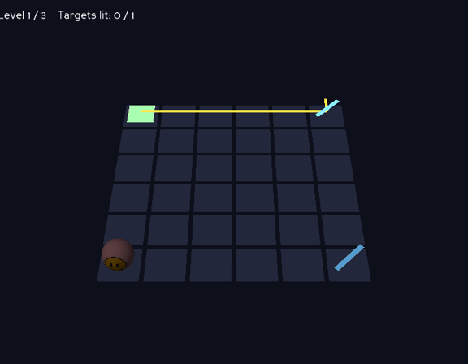

# Beam Bender

A minimalist 3D grid puzzle built with **Panda3D**. Rotate the mirrors so the
emitter's beam reflects across the board and lights **every** target. The beam
re-traces instantly as you turn a mirror.



## Features
- Deterministic beam tracing across a grid, reflecting off `/` and `\` mirrors.
- Multiple levels; a level is solved when all targets are lit.
- Clean low-poly 3D board with a lit beam path.

## Controls
| Key | Action |
|-----|--------|
| Tab | cycle the selected mirror |
| Space | rotate it (`/` ↔ `\`) |
| R | reset the level |
| Esc | quit |

## Run
```bash
pip install panda3d
python beam_bender.py
```
**Self-contained** — it uses only shapes/models that ship with Panda3D, so there
are no external assets to download.

## Tech
Panda3D · procedural board geometry · `LineSegs` beam rendering · grid-based
reflection logic.
